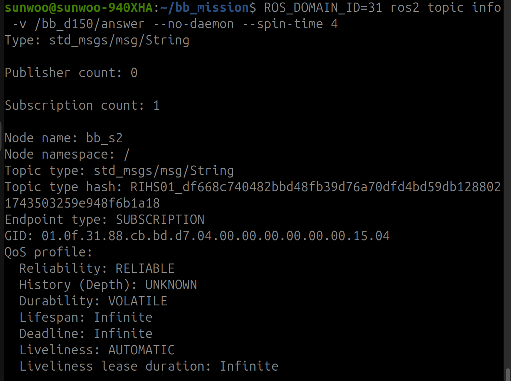

# 블랙박스 로봇 미션 보고서

# 1단계. 정찰

## 1-1. 정보 조사

먼저 어떻게 스캔할건지를 정했다. 어떤 정보를 스캔 스크립트에 넣을지 알아보고자 터미널에 ros2 topic list --help 를 입력하였다. 결과는 사진과 같다.


-s는 시뮬레이션 시간에 대한 내용이고, 지금은 시뮬레이터를 사용하지 않아 의미없다. -c(토픽 개수), --include-hidden-topics(숨겨진 토픽. 로봇 토픽은 bb로 확실했다.), -v(스캔에서는 이름만 보고 자세한 정보는 다음 과정에서 봤다.)

## 1-2. 스캔 스크립트


+ ROS_DOMAIN_ID: 도메인 몇번인지

+ ros2 topic list: 토픽 명령 보여줌

+ --no-daemon --spin-time 4: 캐시(한 번 조사한 결과를 기억해둔다. 이로인해 새로 data가 생기면 못찾는 문제가 있긴 하다.)없이 4초간 직접 찾음

+ -t: 토픽의 타입을 보여줌

+ grep bb_: 결과 중에서 bb_가 들어간 줄을 찾는다.

## 1-3. 스캔 결과

[scan_result.txt](https://github.com/user-attachments/files/34438680/scan_result.txt)

4개 도메인에서 bb_ 토픽이 보였다. 이 중 어느 것이 정찰 신호인지는 토픽 이름만으로는 알 수 없어서 하나씩 조사했다.

## 2-1. 토픽 조사

각 토픽을 로봇이 보내는 건지(Publisher) 받는 건지(Subscription) 알아보기 위해 `ros2 topic info`를 사용했다. 처음에는 `ROS_DOMAIN_ID`를 `ROS2_DOMAIN_ID`로 잘못 입력했다. 이름이 틀리면 ROS 2가 변수를 무시하고 기본값인 0번 도메인에서 실행하기 때문에 제대로 된 결과가 나오지 않았다.(조용함. 아무 결과가 나오지 않았다.)


ack는 Publisher가 0, Subscription이 1이다. 토픽은 메시지가 아니라 통로 이름이라서 듣는 쪽만 있어도 목록에 보인다. 로봇이 이 토픽을 듣고 기다리고 있으니 나중에 응답을 보낼 곳일 수 있다고 생각했다.


config와 stream은 반대로 Publisher가 1이다. 로봇이 말하고 있는 토픽이라 메시지를 읽어 볼 수 있다. 

## 2-2. Unknown topic 문제

나머지 토픽도 같은 방법으로 조회했는데, 스캔에서는 분명히 보였던 토픽이 `Unknown topic`으로 나왔다.

```bash
ROS_DOMAIN_ID=45 ros2 topic info /bb_d150/telemetry
ROS_DOMAIN_ID=31 ros2 topic info /bb_d150/answer
ROS_DOMAIN_ID=72 ros2 topic info /bb_d150/cmd
ROS_DOMAIN_ID=73 ros2 topic info /bb_d150/cmd
```
```
Unknown topic '/bb_d150/telemetry'
Unknown topic '/bb_d150/answer'
Unknown topic '/bb_d150/cmd'
Unknown topic '/bb_d150/cmd'
```


스캔할 때는 `--no-daemon --spin-time 4`를 썼는데, 이번에는 옵션 없이 실행해서 daemon(캐시)을 사용했다. 조건이 달랐기 때문에 `ros2 topic info --help`로 같은 옵션이 있는지 확인했다.


info에도 `--no-daemon`, `--spin-time`이 있어서 스캔과 같은 조건으로 다시 조회했다.


이번에는 모두 보였다. 토픽은 계속 있었고, daemon의 캐시가 아직 발견을 다 끝내지 못해서 Unknown이 나온 것이었다.

조사한 결과를 정리하면 다음과 같다.

| Domain | 토픽 | 타입 | Pub | Sub | 로봇 역할 |
|---|---|---|---|---|---|
| 31 | config | String | 1 | 0 | 말함 |
| 31 | stream | String | 1 | 0 | 말함 |
| 31 | answer | String | 0 | 1 | 들음 |
| 45 | telemetry | String | 1 | 0 | 말함 |
| 45 | ack | String | 0 | 1 | 들음 |
| 72 | cmd | Int32 | 1 | 0 | 말함 |
| 73 | cmd | Int32 | 0 | 1 | 들음 |

## 3-1. 메시지 읽기

로봇이 말하는 토픽의 메시지를 `ros2 topic echo`로 읽었다. `--once`는 메시지 하나만 받고 끝내는 옵션이고, `timeout 10`은 10초 안에 메시지가 안 오면 자동으로 끝내도록 붙였다.


메시지 끝이 `...`로 잘려서 다음 신호 부분이 보이지 않았다.

## 3-2. 메시지가 잘리는 문제

메시지가 길어서 잘린 것 같아 `length`라는 단어로 echo의 옵션을 찾아봤다.


+ grep -i: 대소문자 구분 없이 찾음

+ -A2: 찾은 줄 아래 2줄도 같이 보여줌 (옵션 설명이 여러 줄이라서)

echo는 기본적으로 128자에서 자르고 `...`를 붙인다. `-f`(`--full-length`)를 붙이면 전체를 볼 수 있다.

## 3-3. 정찰 신호 찾기

`-f`를 붙여서 나머지 토픽을 읽었다.


세 메시지를 비교해서 정찰 신호를 판단했다.

| Domain | 메시지 | 판단 |
|---|---|---|
| 45 | BB1로 시작, 챌린지·응답할 곳·다음 신호가 있음 | 정찰 신호 |
| 31 | BB2로 시작, 2단계 설명과 내용이 같음 | 2단계 신호 (정찰 신호의 "다음 신호: 도메인 31"과도 맞음) |
| 72 | 숫자만 있음 | 정찰 신호 아님 |

+ 정찰 신호: Domain 45, `/bb_d150/telemetry`

+ 챌린지 단어: `JUNIPER-3633`

+ 응답할 곳: `/bb_d150/ack` (2-1에서 Pub 0, Sub 1로 로봇이 듣고 있던 토픽)

+ 다음 신호: Domain 31

## 4-1. 응답 방법 조사

`ros2 topic pub`으로 챌린지 단어를 보내야 한다. 그런데 pub을 실행하면 새로 참가자가 생기고, 로봇의 구독자를 발견하는 데 시간이 걸린다. 발견하기 전에 메시지를 보내고 끝나 버리면 전달이 안 될 수 있어서 옵션을 찾아봤다.

```bash
ros2 topic pub --help | grep -i -A2 -E "once|times|rate|wait"
```

## 4-2. 챌린지 응답

+ -t 5: 한 번만 보내면 놓칠 수 있어서 5번 보냄

+ -w 1: 로봇의 구독자를 찾은 뒤에 보냄

+ --max-wait-time-secs 20: 짝이 안 맞으면 무한히 기다리게 되므로 20초로 제한


## 결과


---

# 2단계. QoS

## 1-1. 2단계 신호 다시 읽기

1단계에서 읽은 config 메시지는 `-f` 없이 읽어서 "다음 신호" 부분이 잘려 있었다. 전체를 다시 읽으려고 했는데 이번에는 경고가 나왔다.


echo는 메시지를 읽기 전에 토픽의 타입을 먼저 알아내야 하는데, 이걸 daemon에게 물어본다. daemon의 캐시에 아직 config가 없어서 타입을 못 알아낸 것이었다. 1단계의 Unknown topic 문제와 같은 원인이다.

`--no-daemon`으로 확인해 보니 토픽은 정상적으로 있었다.

그래서 토픽 이름 뒤에 타입을 직접 적어 줬다. 타입은 1단계 스캔에서 `-t`로 이미 알아둔 `std_msgs/msg/String`이다. 타입을 알려 주면 echo가 daemon에게 묻지 않는다.


+ A 값: `6d41` (config의 word= 뒤)

+ B 값: stream의 word= 뒤

+ 응답 형식: `A-B`

+ 응답할 곳: `/bb_d150/answer` (Domain 31)

+ 조건: 구독 노드가 켜져 있는 동안 보내야 함

+ 다음 신호: Domain 72의 `/bb_d150/cmd` (4단계)

## 1-2. QoS란

QoS는 메시지를 어떤 방식으로 배달할지에 대한 약속이다. 이번 단계에서는 두 가지만 보면 된다.

+ Reliability: 확실하게 배달할지. RELIABLE은 등기(잃어버리면 다시 보냄), BEST_EFFORT는 일반 우편(한 번 던지고 끝)

+ Durability: 늦게 온 사람한테도 줄지. TRANSIENT_LOCAL은 게시판 공지(나중에 와도 볼 수 있음), VOLATILE은 라이브 방송(그 순간 듣던 사람만)

보내는 쪽(Publisher)과 받는 쪽(Subscription)이 각자 방식을 정하는데, 받는 쪽이 보내는 쪽보다 까다로우면 연결이 안 된다. 그리고 에러 없이 조용히 데이터만 안 온다.

## 2-1. 두 토픽의 QoS 조사

`ros2 topic info -v`로 config와 stream이 어떤 QoS로 발행되는지 확인했다. `-v`는 노드 이름, 타입, QoS까지 자세히 보여주는 옵션이다.


| 항목 | config | stream |
|---|---|---|
| Reliability | RELIABLE (등기) | BEST_EFFORT (일반 우편) |
| Durability | TRANSIENT_LOCAL (게시판 공지) | VOLATILE (라이브 방송) |

미션 설명과 그대로 맞았다. config는 나중에 접속해도 받을 수 있어야 하는 토픽이고, stream은 흘러가는 스트림이다.


## 2-2. 왜 기본 설정으로는 안 되나

구독 노드를 만들 때 QoS를 따로 정하지 않으면 기본값(RELIABLE, VOLATILE, KEEP_LAST 10)이 쓰인다. 이걸로 두 토픽을 받으면 이렇게 된다.

config

| 정책 | Pub 제공 | Sub 요청 (기본) | 결과 |
|---|---|---|---|
| Reliability | RELIABLE | RELIABLE | 연결 |
| Durability | TRANSIENT_LOCAL | VOLATILE | 연결은 되지만 지난 값은 못 받음 |

연결은 되지만 라이브로만 들으니까 이미 붙어 있는 공지를 못 본다. 노드를 config가 발행된 뒤에 켜면 값을 받을 수 없다.

stream

| 정책 | Pub 제공 | Sub 요청 (기본) | 결과 |
|---|---|---|---|
| Reliability | BEST_EFFORT | RELIABLE | 연결 불가 |
| Durability | VOLATILE | VOLATILE | 같음 |

일반 우편밖에 못 보내는데 등기를 요구하니까 아예 연결이 안 된다. best effort 발행자 + reliable 구독자는 교재에 나온 대표적인 실패 조합이다.

그래서 구독 노드의 QoS를 이렇게 맞췄다.

| 토픽 | Reliability | Durability | 이유 |
|---|---|---|---|
| config | RELIABLE | TRANSIENT_LOCAL | 늦게 켜도 로봇이 들고 있는 값을 받으려고 |
| stream | BEST_EFFORT | VOLATILE | RELIABLE을 요청하면 연결이 안 돼서 |

`ros2 topic echo`로는 config가 따로 설정 없이도 읽혔는데, echo는 발행자의 QoS를 보고 자동으로 맞춰서 구독하기 때문이다. 직접 만든 노드는 정하지 않으면 기본값을 쓴다.

## 3-1. 구독 노드 만들기 (config)

교재 3장의 "QoS를 지정한 구독 노드" 예제를 바탕으로 먼저 config 하나만 받는 노드를 만들었다.

+ import: ROS 2 도구, QoS 도구, String 메시지 타입을 가져옴

+ config_qos: RELIABLE + TRANSIENT_LOCAL, depth 1 (하나만 받으면 돼서)

+ create_subscription(타입, 토픽, 콜백, QoS): 토픽 구독 신청.

+ config_cb: 메시지가 올 때마다 실행되는 함수(콜백). 받은 내용을 출력

+ rclpy.spin: 노드를 끄지 않고 계속 켜 둔 채 메시지를 기다림


노드를 방금 켰는데도 config가 바로 왔다. 로봇이 훨씬 전에 보낸 메시지인데도 받은 건 TRANSIENT_LOCAL로 구독했기 때문이다.

메시지를 받은 뒤에도 프로그램이 끝나지 않고 멈춘 것처럼 보였는데, `rclpy.spin` 때문에 다음 메시지를 기다리는 정상 상태였다. config는 한 번만 오기 때문에 더 출력되는 게 없었다.
## 3-2. 구독 노드 만들기 (stream 추가)

stream을 받도록 세 군데를 추가했다.

+ stream_qos: BEST_EFFORT + VOLATILE, depth 10 (계속 흘러와서 조금 넉넉하게)

+ stream 구독 신청: config 줄과 토픽 이름, 콜백, QoS만 다름

+ stream_cb: stream 메시지가 오면 출력

처음에는 코드를 바꿨는데도 stream이 나오지 않았다. Ctrl+C 했을 때 나온 에러에 `rclpy.spin`이 24번째 줄이라고 나왔는데, 이건 stream을 추가하기 전 코드의 줄 번호였다. 파일이 저장되지 않았던 것이다. `grep -n "stream" bb_subscriber.py`로 확인하고 다시 저장했다.


## 3-3. 수신 결과


+ config는 한 번만 옴 (게시판 공지)

+ stream은 계속 옴 (라이브 방송). 시간이 0.1초 간격이라 1초에 10번 보내고 있다

+ n은 일련번호. 1씩 빠짐없이 증가해서 잃어버린 메시지가 없었다

+ word=7770은 계속 같아서 B 값으로 확정

교재에서 카메라·라이다처럼 자주 오는 데이터는 하나 놓쳐도 다음 것이 곧 오기 때문에 재전송보다 빠른 쪽이 낫다고 했는데, stream이 BEST_EFFORT인 이유와 같다.

응답할 값: `6d41-7770`

## 4-1. answer 토픽 확인

보내기 전에 로봇이 answer를 어떤 방식으로 받는지 확인했다.



로봇(bb_s2)은 answer를 RELIABLE + VOLATILE로 구독하고 있다. `ros2 topic pub`의 기본값도 RELIABLE + VOLATILE이라 그대로 보내도 연결된다.

config, stream을 발행하던 노드와 answer를 구독하는 노드가 같은 bb_s2다. 로봇 노드 하나가 말하기도 하고 듣기도 한다.

## 4-2. 응답 + 결과

미션 조건대로 구독 노드를 켜 둔 채로 다른 터미널에서 응답을 보냈다.

+ 터미널 A: 로봇

+ 터미널 C: 구독 노드 (켜 둠)

+ 터미널 B: 응답 보내기


1단계와 같은 옵션을 썼고, 방 번호(31), 토픽(answer), 내용(6d41-7770)만 ㄴ바꿨다.

# 3단계. 통신 환경 설정(힌트 활용-2,3번)

## 1-1. 요구사항 받기

`check3`를 처음 실행하면 내 이름에 맞춘 요구사항이 나온다.


## 1-2. 요구사항의 의미

+ ROS_DOMAIN_ID=86: 검사가 86번 도메인에서 진행됨. 

+ 주소를 알려줬기 때문에 멀티캐스트로 외치는 대신 이 주소로 직접 찾아간다.

+ AllowMulticast는 false 또는 spdp: 멀티캐스트(라디오 방송)를 끄거나 줄이라는 뜻.

+ MaxAutoParticipantIndex는 5: 멀티캐스트 없이 피어로 찾을 때는 상대의 포트를 participant 번호 순서대로 두드려 본다. 포트 = 7400 + 250 × 도메인 + 2 × participantId + offset 이므로, 0~5번 participant의 포트까지만 찾아보라는 뜻

+ Tracing: Cyclone의 작업 로그. Verbosity는 얼마나 자세히 쓸지, OutputFile은 어디에 저장할지. 설정이 실제로 적용됐는지 로그로 확인하기 위해 필요하다

## 2-1. 공식 문서에서 위치 찾기

| 요구사항 | 문서의 위치 | 설명 |
|---|---|---|
| AllowMulticast | `//CycloneDDS/Domain/General/AllowMulticast` | 발견과 데이터에 멀티캐스트를 쓸지 |
| Peers | `//CycloneDDS/Domain/Discovery/Peers` | 발견에 쓸 주소를 직접 지정 |
| Peer | `//CycloneDDS/Domain/Discovery/Peers/Peer[@Address]` | 발견 패킷을 보낼 IP 주소 |
| MaxAutoParticipantIndex | `//CycloneDDS/Domain/Discovery/MaxAutoParticipantIndex` | 자동으로 정하는 participant 번호의 최댓값 (기본 9) |
| Verbosity | `//CycloneDDS/Domain/Tracing/Verbosity` | 로그 상세도 |
| OutputFile | `//CycloneDDS/Domain/Tracing/OutputFile` | 로그 저장 위치 (기본 cyclonedds.log) |
| Domain | `//CycloneDDS/Domain[@Id]` | 적용할 도메인. any면 모든 도메인 |

경로의 `/`는 "~ 안에"라는 뜻이다. `CycloneDDS` 안의 `Domain` 안의 `General` 안에 `AllowMulticast`를 넣는 식이다. `[@Address]`처럼 `@`가 붙은 건 상자 안의 내용이 아니라 상자에 붙이는 속성이다.

## 2-2. 값 고르기

AllowMulticast 문서 내용

+ spdp: "나 여기 있어요"(SPDP)만 멀티캐스트로 외치고, 나머지(SEDP, 데이터)는 전부 1:1로 보냄

+ false: 멀티캐스트를 완전히 끔

+ default: Wi-Fi면 spdp, 유선이면 true로 동작함. Cyclone이 Wi-Fi는 멀티캐스트를 잘 못 다룬다는 걸 고려해서 기본값을 다르게 둔 것이다

false를 골랐다. 멀티캐스트를 완전히 끄면 통신이 됐을 때 Peers 설정만으로 상대를 찾았다는 확실한 증거가 된다.

Verbosity에 쓸 수 있는 값

| 값 | 기록하는 것 |
|---|---|
| none | 없음 (기본값) |
| severe | 심각한 에러 |
| warning | + 경고 |
| info | + 일반 정보 |
| config | + 설정 내용 |
| fine | + 발견 과정 |
| finer | + 통신량, 타이밍 |
| finest | + 모든 추적 정보 |

문서에 현재 가장 쓸모 있는 단계는 config, fine, finest라고 나와 있다. 설정 내용과 함께 피어로 찾는 발견 과정까지 보려고 fine을 골랐다.

## 2-3. XML 작성

찾은 위치대로 `~/cyclonedds_bb.xml`을 작성했다.


```
CycloneDDS
└── Domain (id="any")
    ├── General
    │   └── AllowMulticast = false
    ├── Discovery
    │   ├── Peers
    │   │   └── Peer (address=127.0.0.1)
    │   └── MaxAutoParticipantIndex = 5
    └── Tracing
        ├── Verbosity = fine
        └── OutputFile = /tmp/bb3_de6dcd7e.log
```

+ `<?xml ...?>`: XML 파일이라는 선언

+ `xmlns="https://cdds.io/config"`: Cyclone 설정 형식을 따른다는 표시

+ `id="any"`: 검사는 86번에서 하지만 any로 두면 어느 도메인이든 적용된다

## 3. 로그에서 찾은 근거

설정 파일을 썼다고 실제로 적용된 건 아니라서, Tracing 로그에서 설정이 읽혔는지 확인했다.

talker와 listener가 같은 파일에 동시에 써서 줄이 서로 붙어 있었다. 그중 필요한 줄만 골랐다.

+ 설정 적용

```
talker: config: Domain/General/AllowMulticast/#text: false {2}
talker: config: Domain/Discovery/Peers/Peer[@Address]: 127.0.0.1 {2}
talker: config: Domain/Discovery/MaxAutoParticipantIndex/#text: 5 {0,2}
```

XML에 적은 값이 그대로 읽혔다. 다른 항목은 대부분 `{}`(기본값)인데 내가 적은 항목에만 `{2}`가 붙어 있어서, 내 XML 파일에서 읽은 값이라고 판단했다.

+ 선택된 인터페이스

```
listener: interfaces: lo udp/127.0.0.1(q1) wlo1 udp/192.168.0.15(q9)
listener: selected interfaces: wlo1 (index 2 priority 0)
```

쓸 수 있는 장치는 lo(127.0.0.1, 나 자신)와 wlo1(192.168.0.15, Wi-Fi) 두 개였고, 그중 Wi-Fi인 wlo1을 골랐다.

+ 피어

```
listener: add_peer_addresses: add udp/127.0.0.1:28910, ...
talker: Unicast Ports: discovery 28912 data 28913
```

포트 번호가 교재 공식과 맞았다. 도메인 86이면 7400 + 250 × 86 = 28900이고,

+ participant 0: 발견 28900 + 10 = 28910

+ participant 1: 발견 28900 + 2 + 10 = 28912, 데이터 28913

listener는 피어 127.0.0.1의 28910(participant 0번)부터 연락처에 추가했고, talker는 participant 1번이라 28912, 28913을 받았다. 로그에 28910, 28912, 28914...처럼 2칸씩 건너뛰는 포트가 나오는 건 participant 번호를 차례로 두드린 것이고, MaxAutoParticipantIndex가 5라서 5번(28920)까지만 찾는다.

로그에는 Ports/Base 7400, DomainGain 250, ParticipantGain 2, Offset 0·10·1·11도 적혀 있어서 교재의 포트 공식 값과 같다는 것도 확인했다.

## 결과


멀티캐스트를 끈 상태에서도 talker와 listener가 통신한 것을 알 수 있다.

# 4단계. 고장 진단

## 1-1. 할 일

로봇의 listener가 로봇의 talker 신호를 받지 못하고 있다. listener 설정 파일(`listener.env`)에 틀린 값이 2~3개 있어서, talker가 실제로 어떻게 말하는지 CLI로 조사해 비교하고 고쳐야 한다. 파일을 고치면 listener가 자동으로 다시 시작되고, 메시지를 5개 받으면 통과다.

이미 알고 있던 단서

+ 2단계 config 메시지 끝: "다음 신호: 도메인 72의 /bb_d150/cmd"

+ 1단계 조사: 72번 `/bb_d150/cmd`는 Pub 1 / Sub 0, 73번 `/bb_d150/cmd`는 Pub 0 / Sub 1

## 1-2. listener 설정 확인


1단계에서 73번 방에 있던 Subscription이 이 listener였다.

## 2. talker 조사

DOMAIN, TOPIC


ID72를 talker로 확정한 근거
+ 1단계에서 10~95까지 전부 스캔했는데, cmd가 보인 곳은 72, 73 두 곳이였다. 하지만 73은 Subscription으로 듣는 쪽만 있으므로 talker가 있을 수 없다. 따라서 72를 talker로 확정했다.


### 연결이 안된 이유

DOMAIN (72 vs 73): 서로를 못 찾는 문제

talker는 72번, listener는 73번 방에 있었다. 포트로 계산하면 72번은 7400 + 250 × 72 = 25400번대, 73번은 25650번대라 층 자체가 다르다. 발견의 첫 단계(SPDP)부터 서로 들리지 않아 존재 자체를 모른다. 1단계 조사 때 72번에는 Pub만, 73번에는 Sub만 있었던 것이 이 증거다.

RELIABILITY (BEST_EFFORT vs reliable): 찾았지만 짝지어지지 않는 문제

talker는 BEST_EFFORT)으로 보내는데 listener는 reliable를 요구한다. Best_effort는 잃어버리면 다시 보내주지않지만, reliable은 잃어버리면 다시 보낸다. 즉 listener는 계속 다시 받아야하는데 talker은 한 번 말해주고 다시 말해주지 않아 문제가 생겼다.

## 3-1. 첫 번째 수정: DOMAIN

방이 다르면 서로 만나지도 못해서 QoS 문제가 숨어 있게 된다. 그래서 DOMAIN을 먼저 하나만 고쳤다.

```bash
nano ~/.ros/robit_blackbox/de6dcd7e/listener.env
```

```
LISTENER_DOMAIN=73  →  LISTENER_DOMAIN=72
```

고친 뒤 다시 조회했다.

```bash
ROS_DOMAIN_ID=72 ros2 topic info -v /bb_d150/cmd --no-daemon --spin-time 4
```


| | Publisher | Subscription |
|---|---|---|
| 노드 | bb_talker4 | bb_listener4 |
| 타입 | std_msgs/msg/Int32 | std_msgs/msg/Int32 |
| Type hash | RIHS01_b657... | RIHS01_b657... (같음) |
| Reliability | BEST_EFFORT | RELIABLE |

수정 전에는 72번에 Subscription이 0이었는데, 이제 `bb_listener4`가 보인다. 같은 방에서 서로를 찾은 것이다. 하지만 토픽, 타입, 타입 해시까지 다 같은데 Reliability가 달라서 짝이 안 지어졌고, 아직 통과가 뜨지 않았다. 찾았지만 짝지어지지 않는 상태를 확인했다.

## 3-2. 두 번째 수정: RELIABILITY

3-1과 같은 방법으로 수정하였다.
```
LISTENER_RELIABILITY=reliable  →  LISTENER_RELIABILITY=best_effort
```

받는 쪽이 best_effort면 보내는 쪽이 reliable이든 best_effort든 둘 다 받을 수 있다. 받는 쪽에서는 가장 덜 까다로운 값이다. talker가 BEST_EFFORT로만 보내므로 여기에 맞췄다.

```bash
ROS_DOMAIN_ID=72 ros2 topic info -v /bb_d150/cmd --no-daemon --spin-time 4
```

## 결과


# 5단계. 자유 탐구

## 1-1. 상황

대회장에서 ROBIT 팀과 다른 팀이 같은 Wi-Fi를 쓴다. 두 팀 모두 로봇에 속도 명령을 `/cmd_vel` 토픽으로 보낸다. 그런데 우리 로봇이 다른 팀의 명령까지 받아서 이상하게 움직인다.

## 1-2. 질문

같은 Wi-Fi, 같은 토픽 이름을 쓰는 두 팀의 명령이 정말 섞일까? `ROS_DOMAIN_ID`를 다르게 하면 분리될까?

## 1-3. 예상

+ 같은 도메인이면 우리 로봇이 두 팀의 명령을 모두 받는다

+ 다른 도메인이면 우리 팀 명령만 받는다. 도메인이 다르면 포트가 달라서 서로를 발견하지 못하기 때문이다

+ 포트 = 7400 + 250 × 도메인 + 2 × participantId + offset 이므로, 50번 방은 19900번대, 51번 방은 20150번대를 쓸 것이다

## 2-1. 실험 방법

터미널 3개를 각각 우리 로봇(X), 우리 팀 PC(Y), 다른 팀 PC(Z)로 정했다. 로봇 과제가 쓰지 않는 50, 51번 방에서 실험했다.

실제 `/cmd_vel`은 `geometry_msgs/msg/Twist`(속도) 타입이지만, 누가 보냈는지 눈으로 구분하기 쉽게 글자(String)로 대신했다.

## 2-2. 실험 ①: 같은 도메인 (문제 재현)


우리 로봇(X)에 두 팀의 명령이 섞여서 들어왔다. 같은 방, 같은 토픽 이름, 같은 타입이면 누가 보냈는지 상관없이 짝이 지어진다. 실제 로봇이었다면 전진과 후진 명령이 번갈아 들어와서 이상하게 움직였을 것이다.

## 2-3. 실험 ②: 다른 도메인 (해결)

다른 팀(Z)만 끄고 51번 방으로 옮겨서 다시 보냈다.


토픽 이름과 타입은 그대로인데 이제 우리 팀 명령만 들어왔다. 10초 동안 지켜봐도 다른 팀 명령은 한 번도 나오지 않았다.

## 2-4. 실험 ③: 포트로 이유 확인

왜 분리되는지 포트 번호로 확인했다. 실험 ②처럼 50번 방에 X, Y, 51번 방에 Z를 켜 둔 상태에서 열린 UDP 포트를 봤다.

```bash
ss -ulnp | grep -E ":(19900|19910|19912|20150|20160)"
ss -ulnp | grep -E ":1991[0-9]"
```

+ ss: 열린 통신 창구(소켓)를 보여줌

+ -u: UDP만, -l: 기다리는 창구만, -n: 숫자로, -p: 어떤 프로그램이 열었는지

50번 방

| 포트 | 공식 | 의미 |
|---|---|---|
| 19900 | 7400 + 250 × 50 + 0 | 발견 멀티캐스트 (같은 방 참가자가 모두 같이 씀) |
| 19910, 19911 | 19900 + 2 × 0 + 10, + 11 | participant 0의 발견, 데이터 창구 |
| 19912, 19913 | 19900 + 2 × 1 + 10, + 11 | participant 1의 발견, 데이터 창구 |
| 19914, 19915 | 19900 + 2 × 2 + 10, + 11 | participant 2의 발견, 데이터 창구 |

51번 방

| 포트 | 공식 | 의미 |
|---|---|---|
| 20150 | 7400 + 250 × 51 + 0 | 발견 멀티캐스트 |
| 20160 | 20150 + 2 × 0 + 10 | participant 0의 발견 창구 |

실제로 열린 포트가 교재 공식과 정확히 같았다. 발견용(offset 10)과 데이터용(offset 11) 창구까지 맞았고, participant 번호가 하나 늘 때마다 2칸씩 늘어났다. 19900번 포트에는 50번 방의 프로그램 세 개가 같이 붙어 있어서, 멀티캐스트 포트는 같은 방이면 모두 같이 쓴다는 것도 확인했다.

50번 방 프로그램들은 19900번에서 외치고 듣는데, 51번 방의 다른 팀은 20150번에서 외친다. 포트가 하나도 겹치지 않아서 서로의 존재 자체를 모른다. 그래서 실험 ②에서 명령이 분리됐다.

## 3. 결론

+ 같은 Wi-Fi에서 같은 도메인, 같은 토픽을 쓰면 다른 팀의 명령이 내 로봇에 들어온다

+ ROS_DOMAIN_ID를 팀마다 다르게 정하면 토픽 이름을 바꾸지 않아도 분리된다

+ 분리되는 이유는 도메인마다 쓰는 포트가 달라서 발견 단계부터 서로를 못 찾기 때문이다.

+ 해결 방법: 대회나 실험실처럼 여러 팀이 같은 망을 쓸 때는 팀마다 Domain ID를 정해 두고, 로봇과 PC 양쪽에 같은 번호를 설정한다

+ Domain ID는 보안 기능이 아니다. 번호만 맞추면 누구든 들어올 수 있으니, 다른 팀과 번호가 겹치지 않게 미리 정해야 한다

## 4. 예상과 달랐던 점

50번 방에 X(echo)와 Y(pub) 두 개만 켰는데, 포트를 보니 참가자가 세 개(19910, 19912, 19914)였다. 프로그램 하나가 예상보다 더 들어와 있었고, 그중 하나는 이름이 `ros2`가 아니라 `python3`였다. 프로그램 수만 세면 participant 수를 정확히 예상할 수 없다는 것을 알았다.

# 아직 이해 못 한 것
과제3번(xml)
+ 포트 계산
+ 자료 분석 - 자료를 보고 키워드를 ctrl+f로 찾아서 어떤걸 써야하는지 찾아보려했지만 잘 되지않았다. 근데 사실 이건 영어실력이 높아지거나 비슷한 자료를 자주 접하면 해결될 것 같다.


# 헷갈렸던 포인트 + 이것저것

+ 1단계. 정찰을 하면서 ack는 Publisher가 0, Subscription이 1인 부분에서 의문증이 생겼다. 로봇이 우리한테 보낸 토픽을 찾는거면 Publisher가 있어야하는게(1이여야하는게) 아닌가?라는 생각을 했다. 알아보니 토픽은 주고받는 메시지 자체가 아니라 오가는 통로의 느낌이라서 publisher, subscription 둘 중 아무거나 하나만 있어도 토픽이 목록에 보인다고한다.

+ 잠시 나갔다와서 과제를 하려고 ROS_DOMAIN_ID...topic info...를 터미널에 치고 토픽을 보려했는데, 1단계에서는 분명 도메인 하나하나 보면서 보였던 토픽이 갑자기 안보이는 문제가 있었다.(있던 토픽이 다 안보였다.) 근데 그냥 단순히 와이파이가 달라져서 그랬던 문제가 있었다.

+ 5단계에서 X, Y 두 프로그램만 켰는데 50번 방에 참가자가 세 개 있었다. 그중 python3 프로세스의 정체가 무엇인지(ros2 daemon인지) 확인하지 못했다.